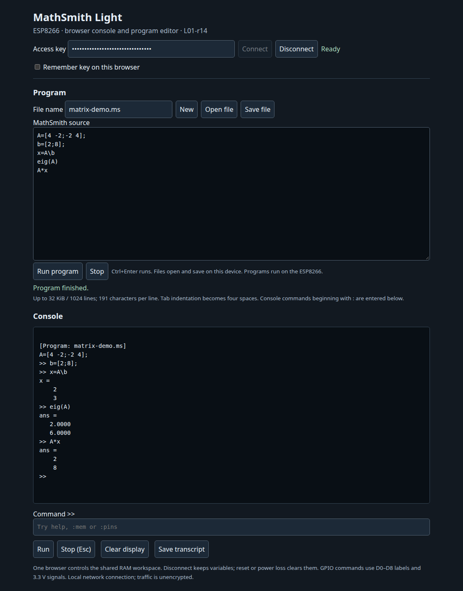

# MatmMax

MatmMax is a MATLAB-inspired numerical environment for small computers. It
supports interactive calculations, matrices and scripting. It belongs to the
Mini-Max suite alongside WordmMax for writing and CodemMax for programming.

| Build | Where to run it | Setup |
|---|---|---|
| **DOS (8086/CGA)** | A compatible DOS PC or DOSBox-X | [Build and run the DOS preview](dos/toshiba/README.md) |
| **ESP8266** | Wemos D1 mini with 4 MB flash, using serial or the browser | [Build and flash the board](docs/GETTING_STARTED.md#esp8266-a-real-wemos-d1-mini-4-mb) |
| **ESP8266 WebREPL demo** | Linux, using a browser connected to a local program | [Run the PC demo](docs/EMULATOR_QUICKSTART.md#6-try-the-webrepl-screenshots-interface-without-an-esp8266) |
| **ESP32-S3** | ESP32-S3 N16R8 firmware in Espressif QEMU | [Run the firmware in QEMU](docs/GETTING_STARTED.md#esp32-s3-run-e03-in-qemu) |

## DOS preview

The preview targets the following configuration. Use it as a starting point
when evaluating another DOS PC.

| Component | Reference configuration |
|---|---|
| CPU | Intel 8086 with software floating point |
| Memory | 640 KB conventional RAM |
| Display | CGA-compatible with 640×200 graphics (BIOS mode 6) for plots |
| OS and storage | DOS 3.30 and a writable directory. The program and examples fit on a 720 KB floppy. |

Build `MATHSMTH.EXE` from source on Linux with Open Watcom. Run it from the
DOS prompt on your PC or use the included 8086/CGA configuration for DOSBox-X.
The executable displays its original MathSmith M08 banner.

Calculations, FFTs, scripts, the editor and plots work offline. The optional
AI helper uses DOS networking and a host running Ollama. [DOS build guide, emulator instructions and AI setup](dos/toshiba/README.md)

Earlier builds ran core calculations, scripts and plots on the reference
machine, a Toshiba T2100. The current source preview passed 243 native and
DOSBox-X checks and awaits a fresh physical test.

## Microcontroller builds

### ESP8266

The Wemos D1 mini build provides a serial console, a browser console
(WebREPL), a browser script editor and scriptable GPIO. The matrix limit is
64 elements (8×8 square). On a physical board, the ESP8266 runs the math
engine and serves the WebREPL over Wi-Fi. In the PC demo, both run in a Linux
program that your browser reaches at `127.0.0.1`. [ESP8266 user manual](esp8266/docs/USER_MANUAL_L01.md)

Board checks were reported for L01-r14. The renamed L01-r15 build awaits
physical validation.

*The ESP8266 WebREPL PC demo running entirely on Linux.*

### ESP32-S3

The E03 firmware provides a serial console, FFTs, matrices up to 64×64, and a
launcher for separately built apps uploaded over serial. It targets the
N16R8 configuration with PSRAM. E03 was tested in Espressif QEMU and awaits
physical board validation. [QEMU walkthrough](docs/EMULATOR_QUICKSTART.md) · [App launcher and upload guide](apps/esp32/e03_external/README.md)

### RP2350

Architecture draft. [Target notes](rp2350/README.md)

### Board reference photos

| Wemos D1 mini (ESP8266) | ESP32-S3 development board |
|:---:|:---:|
|  |  |

Photos by Tpkull and VectorVoyager, licensed under CC BY-SA 4.0. The ESP32-S3
photo shows the board family. [Image sources and license](docs/IMAGE_CREDITS.md)

## Project links

- [MatmMax project website](https://hgamoreira.github.io/matmmax/)
- [MatmMax language manual](esp8266/docs/USER_MANUAL.md)
- [Microcontroller validation and open checks](PROGRESS.md)
- [Contribution and test instructions](CONTRIBUTING.md)
- [MIT license](LICENSE) · [Third-party notices](THIRD_PARTY_NOTICES.md)
