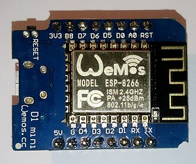
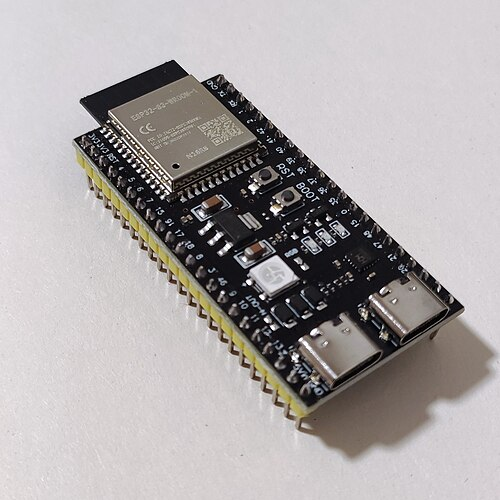

# MatmMax

MatmMax is the numerical application in the Mini-Max suite, alongside
WordmMax for writing and CodemMax for programming. The suite grew out of
work on the Commodore 64 and MS-DOS. This repository covers the ESP8266
and ESP32-S3 ports of the MATLAB-inspired numerical environment. The v0.1.0
source preview predates the MatmMax name.

## Choose where to run MatmMax

The WebREPL is the browser interface. **The calculations run in the program
that the browser connects to.** Choose one of these setups:

| Setup | Where calculations run | How you use it |
|---|---|---|
| **Real ESP8266 board** | On your Wemos D1 mini | Open the board's Wi-Fi address in your browser. [Hardware setup](#use-a-real-esp8266-board). |
| **ESP8266 WebREPL PC demo — no board** | In a Linux program on your computer | Open the local program's `127.0.0.1` address in your browser. [PC demo setup](#esp8266-pc-demo-on-linux-no-board). |
| **ESP32-S3 in QEMU — no board** | In ESP32-S3 firmware inside the emulator on your computer | Use the terminal console. [QEMU setup](#esp32-s3-firmware-in-qemu-no-board). |

## Hardware reference photos

| Wemos D1 mini (ESP8266) | ESP32-S3 development board |
|:---:|:---:|
|  |  |

Reference photos; board revisions vary. The ESP32-S3 photo illustrates the
board family and does not confirm the N16R8 target's memory configuration.
Photos by [Tpkull](https://commons.wikimedia.org/wiki/File:WeMos_D1_Mini_front.jpg)
and [VectorVoyager](https://commons.wikimedia.org/wiki/File:ESP32-S3_on_paper.jpg),
[CC BY-SA 4.0](https://creativecommons.org/licenses/by-sa/4.0/).
See [image credits](docs/IMAGE_CREDITS.md) for sources and image details.

## WebREPL screenshot


**Screenshot: the PC demo running entirely on Linux, with no ESP8266 connected.**
The browser displays the editor and results; the local Linux program performs
this matrix calculation. The same browser interface is also available from
firmware installed on a real ESP8266 board.

| Target | Working version | Validation |
|---|---|---|
| **ESP8266 Wemos D1 mini, 4 MB** | **L01-r15**: serial and browser console, saved Wi-Fi, browser script editor, scriptable GPIO | Board checks were reported for L01-r14. The renamed L01-r15 build awaits board testing. The full peripheral/stress procedure remains open. |
| **ESP32-S3 N16R8** | **E03**: serial MatmMax, FFT, app launcher, separate ELF apps uploaded over serial | Tested in Espressif QEMU. Physical board validation pending. |
| RP2350 with PSRAM | Architecture draft | No working RP2350 firmware yet. |

Both working targets use **64-bit doubles** and the same portable MatmMax
engine. ESP8266 limits matrices to 64 elements (8×8 square), with 16 variables
and a 16 KiB engine payload budget. ESP32-S3 allows 4096 elements (64×64
square) and uses PSRAM. Limits are allocations, not a promise that every
combination fits in memory.

```text
>> A=[4 -2;-2 4]
>> A\[2;8]
ans =
   2
   3
```

## Run on your computer — no board required

Choose either route below. If you already cloned the repository, use its
existing folder and skip the clone/cd lines.

### ESP8266 PC demo on Linux (no board)

**In this setup, both the WebREPL server and the math engine run on your
computer. No ESP8266 is connected.** Your browser connects to that local
program, using an address beginning with `http://127.0.0.1:`.

On **x86_64 Linux**, you need Python **3.12+**, Git and GCC/G++. On
Ubuntu/Debian, `sudo apt-get install git python3 build-essential` supplies the
packages; check that your distribution's Python meets the version requirement.
No ESP8266 board, USB adapter, ESP-IDF, QEMU or cross-compiler is needed.

```sh
git clone https://github.com/hgamoreira/matmmax.git
cd matmmax
MS_NATIVE_WIFI=1 esp8266/scripts/webrepl.sh native
```

Keep the terminal open. Copy the complete **Browser URL** it prints into a
browser on the same computer, then click **Connect**. Try `2+2` in the console,
use the program editor, and open/save scripts on your computer. Stop the
harness with **Ctrl+C** in the terminal when finished.

This is a PC demonstration of the ESP8266 version, built from the same UI
and math sources. It is a native Linux program, rather than ESP8266 CPU
emulation. GPIO/ADC and Wi-Fi use test stubs; they do not control real pins
or connect a board to a network. See the
[WebREPL walkthrough](docs/EMULATOR_QUICKSTART.md#6-try-the-webrepl-screenshots-interface-without-an-esp8266)
for the matrix example shown above.

### ESP32-S3 firmware in QEMU (no board)

Run the ESP32-S3 firmware in Espressif QEMU on **x86_64 Linux**. After
installing the [Linux prerequisites](docs/EMULATOR_QUICKSTART.md#1-install-linux-prerequisites):

```sh
git clone https://github.com/hgamoreira/matmmax.git
cd matmmax
tools/setup_esp_idf.sh
tools/setup_esp_qemu.sh
tools/setup_elf_loader.sh
esp32/scripts/external.sh build
python3 esp32/scripts/upload_external.py --qemu build/esp32/e03_external/demo_b.msp
```

At `>>`, try `2+2`, then `x=41`, `:app uploaded`, `exit`, and `x+1` (42).
Press **Ctrl+]** to close the emulator console. Enter each line at its current
prompt. The [full emulator guide](docs/EMULATOR_QUICKSTART.md) covers tool
installation, expected results, tests, troubleshooting, and running the
**WebREPL on your computer** with the native ESP8266 test harness.

## Start here

- [Build and first use](docs/GETTING_STARTED.md): ESP8266 on a board or ESP32-S3 in QEMU.
- [ESP8266 browser/GPIO manual](esp8266/docs/USER_MANUAL_L01.md) and [math language manual](esp8266/docs/USER_MANUAL.md).
- [ESP32-S3 external apps](apps/esp32/e03_external/README.md) and [app ABI](docs/WORKSTATION_APP_ABI.md).
- [Validation status](PROGRESS.md), including the remaining hardware checks.
- [Project website](https://hgamoreira.github.io/matmmax/).

## Use a real ESP8266 board

**In this setup, MatmMax and the WebREPL server run on the ESP8266.** Your
computer's browser displays the editor and sends commands over Wi-Fi. The
ESP8266 performs the calculations and controls its physical GPIO pins.

1. Connect a Wemos D1 mini with 4 MB flash over USB and follow the
   [firmware build/flash instructions](docs/GETTING_STARTED.md#esp8266-a-real-wemos-d1-mini-4-mb).
2. In its serial console, enter `:wifi join` and supply your network details.
3. Enter `:wifi`, then open the complete **Browser URL** it prints. This is
   the board's network address, not the PC demo's `127.0.0.1` address.

After a successful connection, network credentials and the browser key are
saved, and subsequent boots reconnect automatically. The browser editor
opens and saves `.ms` files **on your computer**, then sends acknowledged
lines to the board. Stop cancels running code. The browser console exposes
the same workspace as serial. After setup, a USB power supply can power the
board; a serial connection to the computer is not needed for browser use.

On the physical board, GPIO can be used inside a script. This blinks the D1 mini's active-low LED:

```text
pinmode('D4','output',1);
for k=1:5
    digitalwrite('D4',0); delay(500);
    digitalwrite('D4',1); delay(500);
end
```

## ESP32-S3 application support

The ESP32-S3 has a foreground app launcher and a versioned API. A separately
compiled demo can be uploaded and run without reflashing the OS; returning
preserves MatmMax variables. Uploaded apps are trusted native code in the
same address space. Uploads are RAM-only and disappear after reboot.

## Current limits

Neither microcontroller build includes AI integration, an attached keyboard,
OLED driver or SD storage. Those remain future milestones. ESP8266 has no
FFT, graphics or native app launcher. Its HTTP/WebSocket browser console is
intended for a trusted local network. The project website hosts documentation.
To use the WebREPL, open the URL printed by your board or by the PC demo,
depending on the setup you chose.

## Development and sharing

Builds are currently supported on **x86_64 Linux**. SDK/compiler versions are
pinned by installers under `tools/`; downloaded dependencies, personal flash
backups and generated firmware stay outside Git. See
[CONTRIBUTING.md](CONTRIBUTING.md) for checks and
[RELEASING.md](docs/RELEASING.md) for GitHub Pages and source releases.

This repository is a curated source snapshot from the larger workstation
project. `EXPORT_MANIFEST.json` records the initial export's provenance and file
checksums; later changes are tracked in Git.
Original project source is [MIT licensed](LICENSE); downloaded SDKs and tools
retain their [own licenses](THIRD_PARTY_NOTICES.md). The initial public
release is source-only.
